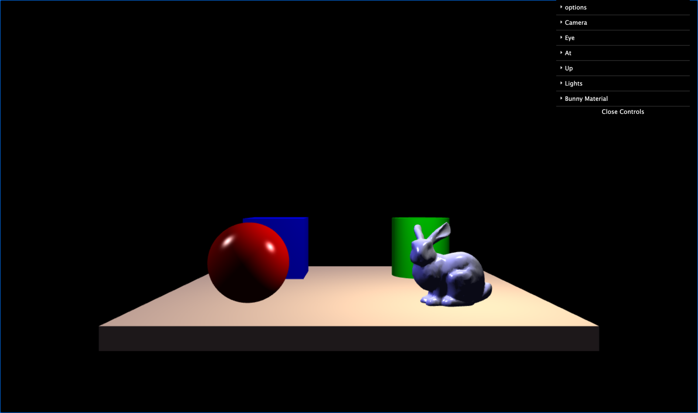

# 💡 Lighting and Shading — Computer Graphics and Interfaces, Project 3

<p>
  
  
  
  
  
</p>

**▶️ [Live demo](https://mccprogrammer.github.io/CGI-Lighting-and-Shading/)** — runs in the browser (desktop, keyboard needed).

Project 3 of *Computação Gráfica e Interfaces* (Computer Graphics and Interfaces), Computer Science degree at **NOVA School of Science and Technology (FCT NOVA)**.

<p align="center"></p>

## About

A WebGL scene that shows how objects look under different lights and materials: a platform with a sphere, a cube, a cylinder and the **Stanford bunny**, viewed through a perspective camera.

- The **Phong reflection model** (ambient, diffuse and specular) computed in camera space, with two shading options: **Phong shading** (per fragment) and **Gouraud shading** (per vertex)
- Up to **3 lights** — point, directional or spotlight — each with its own position, colour and intensities, and can be turned on and off
- Editable **material** of the bunny (Ka, Kd, Ks and shininess)
- Toggle **back-face culling** and the **depth buffer** to see what each one does
- Camera and lights controlled from a **dat.GUI** panel


## Running it

WebGL apps load their shaders with `fetch`, so they need to be served over HTTP (opening `index.html` directly won't work):

```bash
python3 -m http.server 8000
# then open http://localhost:8000
```

## What I learned

- The Phong illumination model and the difference between Gouraud and Phong shading
- Transforming normals correctly (normal matrix) and lighting in camera space
- Point, directional and spot lights, and material properties
- Hidden surface removal: back-face culling vs. z-buffer

## Credits

- **Miguel Carmo** ([@MCCProgrammer](https://github.com/MCCProgrammer))
- **Tomás Ramos Alves** ([@Alvesss04](https://github.com/Alvesss04))

`libs/` (`MV.js`, `stack.js`, `utils.js`, the primitive objects, the bunny model and dat.GUI) was provided by the CGI teaching staff; the app and the shaders were written by us.

---

<sub>The assignment statement is not included in this repository, as it belongs to the course's teaching staff. This is a student project shared for portfolio purposes.</sub>
